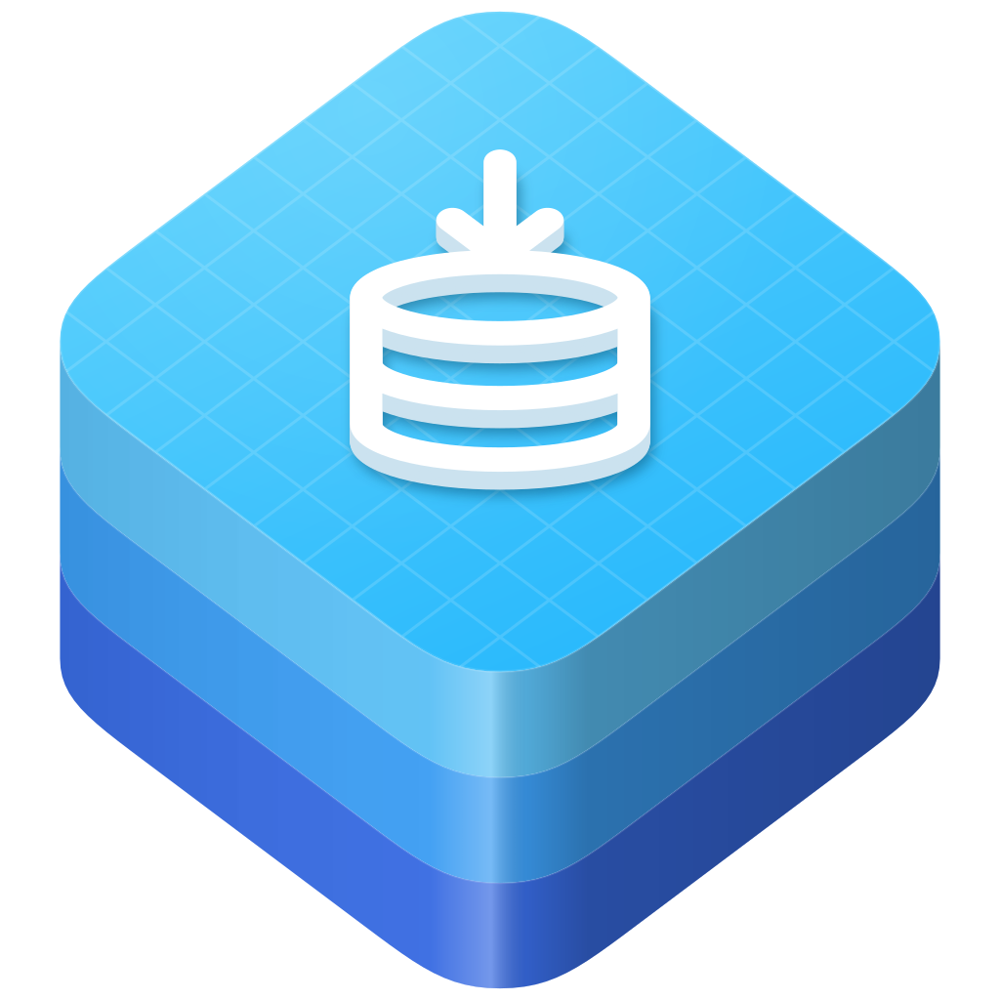

<div align="center">

<p align="center">
  <a href="https://github.com/swift-library/swift-data-writable"></a>
</p>

<h1 align="center">swift-data-writable</h1>

<p align="center">
  Insert, delete, and reorder SwiftData query results through a projected collection.
</p>

<p align="center">
  <a href="https://github.com/swift-library/swift-data-writable/actions/workflows/ci.yml"></a>
  
  
  <a href="LICENSE.txt"></a>
</p>

<p align="center">
  <a href="#overview">Overview</a> ·
  <a href="#quick-look">Quick look</a> ·
  <a href="#install">Install</a> ·
  <a href="#usage">Usage</a> ·
  <a href="#requirements">Requirements</a> ·
  <a href="#documentation">Documentation</a> ·
  <a href="#contributing">Contributing</a> ·
  <a href="#license">License</a>
</p>

</div>

## Overview

Give a SwiftUI list a write companion while `@Query` remains its read source. `@Writable` routes edits through the view’s `ModelContext`, and sorted moves reuse the configured ordering field; the [usage guide](Documentation/Reference/Usage.md) explains saves, relationships, and limits.

## Quick look

With the `Person` model from the [usage guide](Documentation/Reference/Usage.md#quick-start):

```swift
import SwiftData
import SwiftDataWritable
import SwiftUI
struct PeopleView: View {
  @Writable @Query(sort: \Person.name) var persons: [Person]
  var body: some View {
    List {
      ForEach(persons) { Text($0.name) }.onDelete(perform: $persons.remove)
      Button("Add") { $persons.append(Person(name: "New")) }
    }
  }
}
```

## Install

Add the package and the `SwiftDataWritable` product to `Package.swift`:

```swift
dependencies: [
  .package(
    url: "https://github.com/swift-library/swift-data-writable.git",
    .upToNextMinor(from: "0.1.1")
  ),
],
targets: [
  .target(
    name: "YourApp",
    dependencies: [
      .product(name: "SwiftDataWritable", package: "swift-data-writable"),
    ]
  ),
]
```

In an Xcode project, add the same URL with File > Add Package Dependencies and
choose the Up to Next Minor Version rule. `@Writable` is a Swift macro, so
Xcode asks you to trust the package before its first build.

> [!NOTE]
> swift-data-writable is pre-1.0. Minor releases may include source-breaking
> changes, so depend on it with `.upToNextMinor(from:)`.

## Usage

Attach `@Writable` to a query or model property, then use its projected companion for edits. Call `save()` explicitly or choose an autosave policy.

The [usage guide](Documentation/Reference/Usage.md) covers the full example, property shapes, query collections, relationships, save errors, transactions, and actor ownership.

## Requirements

- Swift 6.2 or later
- iOS 18 or later, macOS 15 or later, tvOS 18 or later, and watchOS 11 or
  later

The compiler minimum is maintained independently of the platform window. The
current system maintenance window is iOS 18, 26, and 27; macOS 15, 26, and 27;
tvOS 18, 26, and 27; and watchOS 11, 26, and 27. The macro implementation uses
SwiftSyntax 602, and `Package.resolved` records the revision used for
validation. The
[release reference](Documentation/Reference/Release.md)
describes compatibility and maintenance: the latest released line receives
fixes, and older-line backports are evaluated per issue.

## Documentation

- [Usage guide](Documentation/Reference/Usage.md): examples, behavior, and limits.
- [Writable combinations](Documentation/Reference/WritableCombinations.md): every
  supported and rejected property shape, its generated surface, and the meaning
  of each method.
- [Architecture](Documentation/Architecture/SwiftDataWritable.md): targets, the macro
  and runtime boundary, and save, relationship, and reordering semantics.
- [API documentation](Sources/SwiftDataWritable/SwiftDataWritable.docc/SwiftDataWritable.md):
  the DocC catalog.
- [Release](Documentation/Reference/Release.md): release facts and mechanics; version rules are in VERSIONING.
- [Changelog](CHANGELOG.md)

## Contributing

Read [CONTRIBUTING.md](CONTRIBUTING.md) before opening a pull request, and run
`Scripts/check` before submitting changes. Report vulnerabilities through the
private route in [SECURITY.md](SECURITY.md).

## License

swift-data-writable is available under the Apache License 2.0 with the Swift
Runtime Library Exception. See [LICENSE.txt](LICENSE.txt) and [NOTICE](NOTICE). NOTICE
also records SwiftSyntax, a package dependency whose own license and notices
remain in its package.
